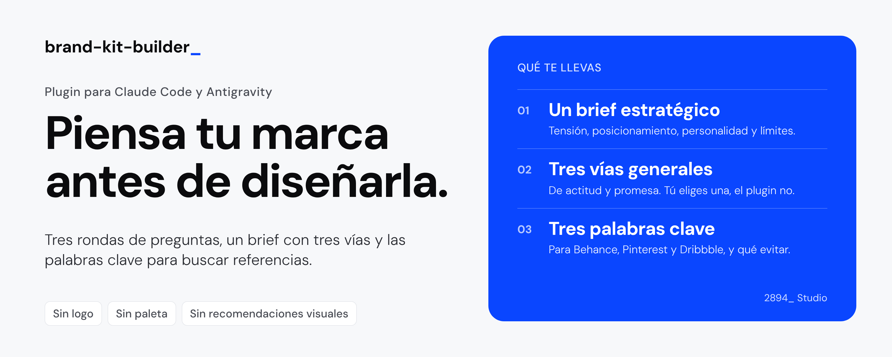

<p align="center">
  
</p>

# brand-kit-builder

**Un plugin para pensar tu marca antes de diseñarla.**

Te hace buenas preguntas en 3 rondas, te devuelve un espejo de lo que oye, y te deja:

1. un **brief estratégico** con **tres vías generales** para tu marca, y
2. **tres palabras clave** para buscar referencias en **Behance, Pinterest y Dribbble**, con **qué buscar y qué evitar** al mirarlas.

Y nada más. **No hace el logo, ni la paleta, ni la tipografía, ni da recomendaciones visuales.** Esto es lo que va *antes*: aclarar qué es tu marca, para quién y qué actitud tiene, para que lo que diseñes después tenga una razón.

Desarrollado por [2894 Studio](https://github.com/2894Studio) a partir del caso práctico de la formación **Marketing potenciado por IA**. Funciona en Claude Code y en Google Antigravity.

## Para quién es

Para estudiantes, emprendedores y equipos que quieren crear o replantear una marca y no saben por dónde empezar, o que ya probaron a pedirle un logo a una IA y les salió genérico. Un buen logo sale de un buen brief; este plugin hace el brief.

## Cómo funciona

| Ronda | Cómo | De qué va |
|---|---|---|
| **1** | **Abierta**, en el chat | Cuentas con tus palabras qué haces, para quién, una escena con un cliente y por qué lo haces tú |
| **2** | Diálogo con opciones | Qué te diferencia, qué puedes demostrar, qué no harías nunca y dónde te colocas |
| **3** | Diálogo con opciones | Cómo se comporta tu marca, con qué no quieres que te confundan y cómo quieres que se sienta tu cliente |

- Tras cada ronda, un **espejo** corto: lo que oye, lo que le llama la atención y lo que aún no sabe.
- Las **opciones de las rondas 2 y 3 salen de lo que tú contaste**, no de un catálogo. Siempre puedes escribir tu propia respuesta.
- Al final, **tres vías generales** de actitud y promesa (por ejemplo, «la que demuestra», «la que acompaña», «la que discute»). Tú eliges una o mezclas dos; el plugin no elige por ti.
- Cierra con la **idea rectora** (una frase), **las tres palabras clave** y **qué buscar y qué evitar** en las referencias.

## Qué te llevas

- `trabajo/<fecha>-marca-<slug>/estrategia.md`: el brief (situación, público y tensión, mapa de la categoría, posicionamiento, promesa y prueba, personalidad, lo que no es, las tres vías, la vía elegida, la idea rectora, lo que aún no sabes, palabras clave y riesgos).
- **Tres palabras clave** generales, por ejemplo `fintech brand identity`, `freelancer invoicing app` y `transparent minimal branding`, **tres cosas que buscar y tres que evitar** en las referencias (por ejemplo, «mucho aire, porque la voz es seca» o «aspecto de agencia corporativa, porque su cliente huye de eso») y la indicación de guardar **3 referencias** (2 que te gustan y 1 que no quieres parecer) anotando qué *actitud* te gusta de cada una.

Un ejemplo completo de brief (ficticio), en [`evals/fixtures/estrategia/brief-bueno.md`](evals/fixtures/estrategia/brief-bueno.md).

## Instalar

En Claude Code:

```
/plugin marketplace add 2894Studio/brand-builder
/plugin install brand-kit-builder@brand-kit-builder
```

Después, escribe **«quiero crear una marca»** (o `/brand-kit-builder`). Para Antigravity y otros agentes, las instrucciones están en [`AGENTS.md`](AGENTS.md).

## Qué NO hace

- No diseña logos, paletas, tipografías, manuales ni piezas visuales.
- No da recomendaciones visuales. Solo hay dos excepciones, siempre en general y con un «porque»: la sensación de cada vía (una palabra: «sobria», «cálida», «atrevida») y, al final, **qué buscar y qué evitar** al mirar referencias (aire, tono, uso de la imagen, ornamento). Nunca colores concretos, fuentes, formas de logo ni marcas para imitar.
- No inventa datos de mercado ni el nombre de tu marca: lo que no comprueba, lo marca como *Supuesto*.
- No es asesoría legal: las anterioridades del nombre y los claims quedan como **pendiente de validación profesional** (OEPM, EUIPO).

## Cómo se comprueba la calidad

- `skills/estrategia/tools/verificar_brief.py` revisa que el brief es un brief y no un formulario: secciones con contenido, tensión con dos mitades, al menos tres alternativas, posicionamiento completo, exactamente tres vías con riesgo, tres cosas por descubrir, tres palabras clave, **sin recomendaciones visuales** y sin léxico de relleno.
- `skills/estrategia/tools/verificar_estrategia.py` es el autotest (acepta un brief bueno y rechaza quince tipos de brief malo). Se ejecuta en Linux, macOS y Windows en cada cambio.
- `evals/e2e/ejecutar.py` simula a una persona respondiendo las tres rondas con un modelo real y mide cuántas preguntas hace por ronda, si se cuela lenguaje visual y si el brief sale correcto.

## Estructura

```
skills/brand-kit-builder/   punto de entrada y criterio de trabajo
skills/estrategia/          el proceso: preguntas, espejo, vías, brief y palabras clave
evals/                      pruebas con un modelo real y un brief de ejemplo
```

## Historial

Hasta la versión 3.2.1 el plugin cubría también logo, paleta, voz, tokens, manual y piezas finales. Se retiró para centrarse en la fase previa; ese código sigue en el historial de git, en el commit [`b1b8134`](../../tree/b1b8134) (versión 3.2.1). Cambios en [`CHANGELOG.md`](CHANGELOG.md).

## Licencia

MIT. © 2026 2894 Studio.
