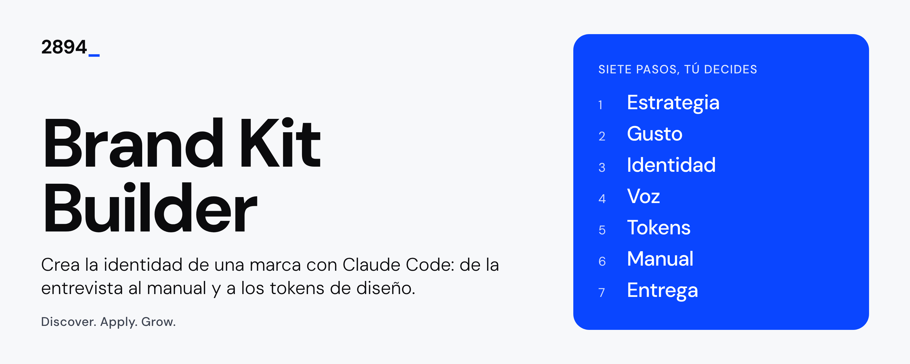
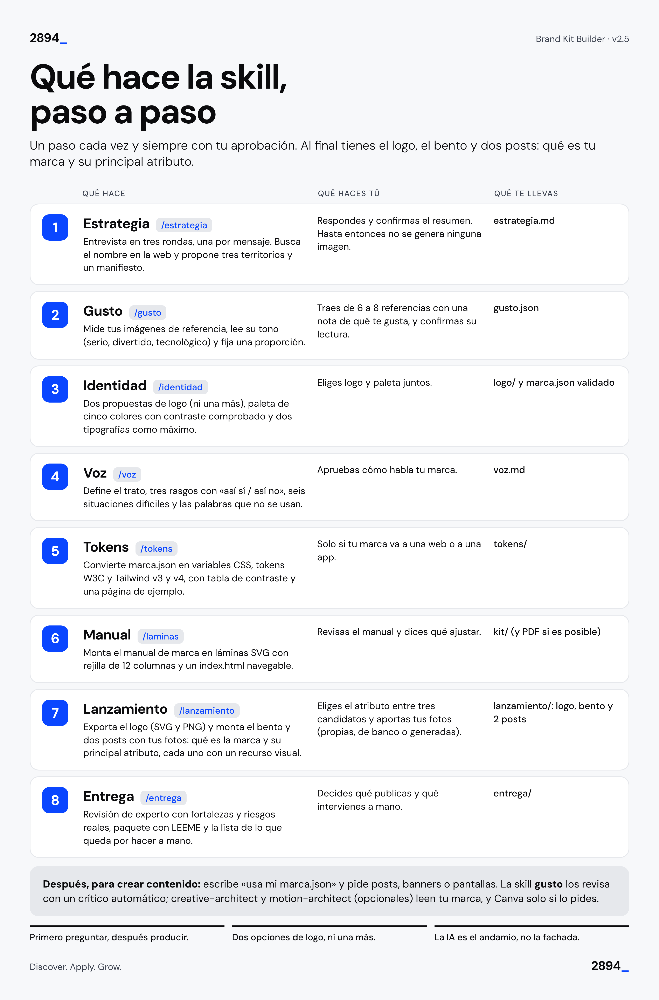

<p align="center">
  
</p>

# brand-kit-builder

Plugin de Claude Code para crear la identidad de una marca de principio a fin: **entrevista, estrategia, logo, paleta, tipografía, voz, tokens de diseño para web y app, y manual de marca**. Funciona sin ninguna herramienta de pago, y deja un `marca.json` que [creative-architect](https://github.com/Hainrixz/creative-architect) ya sabe leer.

Desarrollado por [2894 Studio](https://github.com/2894Studio) a partir del caso práctico de la formación **Marketing potenciado por IA**.

## Qué te llevas al final

- **El logo**, en SVG y en PNG con fondo transparente.
- **El bento de la marca**: logo, símbolo, color, tipografía, voz, fotografía y proporción de tonos en un solo tablero.
- **Dos posts**: el primero explica **qué es la marca** y el segundo muestra **su principal atributo**, los dos de forma visual (una interfaz, un mapa, una cifra con su fuente, una persona con su rol).
- Además, el manual de marca, los tokens de diseño para web y app y `marca.json`.

## Cómo funciona, paso a paso

Un paso cada vez, y **siempre con tu aprobación**: sin tu visto bueno no pasa al siguiente.

<p align="center">
  
</p>

| # | Paso | Qué hace la skill | Qué haces tú | Te llevas |
|---|---|---|---|---|
| 1 | `/estrategia` | Entrevista en tres rondas (una por mensaje), busca el nombre en la web, propone tres territorios y un manifiesto | Respondes y confirmas el resumen; hasta entonces no se genera ninguna imagen | `estrategia.md` |
| 2 | `/gusto` | Mide tus imágenes de referencia, lee su tono (serio, divertido, tecnológico) y fija una proporción | Traes de 6 a 8 referencias con una nota de qué te gusta y confirmas su lectura | `gusto.json` |
| 3 | `/identidad` | Dos propuestas de logo (ni una más), paleta de cinco colores con contraste comprobado y dos tipografías como máximo | Eliges logo y paleta juntos | `logo/` y `marca.json` validado |
| 4 | `/voz` | Define el trato, tres rasgos con «así sí / así no», seis situaciones difíciles y las palabras que no se usan | Apruebas cómo habla tu marca | `voz.md` |
| 5 | `/tokens` | Convierte `marca.json` en variables CSS, tokens W3C y Tailwind v3 y v4, con tabla de contraste y página de ejemplo | Solo si tu marca va a una web o una app | `tokens/` |
| 6 | `/laminas` | Monta el manual de marca en láminas SVG con rejilla de 12 columnas y un `index.html` navegable | Revisas el manual y dices qué ajustar | `kit/` (y PDF si es posible) |
| 7 | `/lanzamiento` | Exporta el logo (SVG y PNG), monta el bento de la marca y **dos posts con tus fotos**: qué es la marca y su principal atributo, cada uno con un recurso visual y revisado por el crítico | Eliges el atributo entre tres candidatos y aportas tus fotos (propias, de banco o generadas) | `lanzamiento/`: logo, bento y 2 posts |
| 8 | `/entrega` | Revisión de experto con fortalezas y riesgos, paquete con LEEME y la lista de lo que queda por hacer a mano | Decides qué publicas y qué intervienes a mano | `entrega/` |

**Después, para crear contenido:** escribe «usa mi `marca.json`» y pide posts, banners o pantallas. La skill `gusto` los revisa con un crítico automático; creative-architect y motion-architect (opcionales) leen tu marca, y Canva solo si lo pides.

## Qué resuelve

- **Una marca que se defiende:** entrevista en tres rondas, territorios anclados fuera de la categoría y un manifiesto con el miedo de la marca. Contra la marca promedio que devuelve la IA por defecto.
- **Una marca que funciona en producto:** los tokens (`tokens.json`, variables CSS, Tailwind v3 y v4) salen del mismo `marca.json` que el manual, con el contraste comprobado. Quien programa no reinterpreta nada.
- **Una marca que no se explica dos veces:** `marca.json` se escribe en cuanto se aprueban logo y paleta, y lo leen las demás skills de creative-architect.
- **Sin dependencias:** el manual sale como SVG y HTML con Python estándar. Canva es un módulo opcional.

## Guías

- [Guía del alumno](docs/guia-alumnos.md): instalación, uso paso a paso y problemas frecuentes.
- [Elegir herramienta](docs/elegir-herramienta.md): creative-architect, motion-architect y video-editor-architect, comparadas.
- [Ahorro de tokens y créditos](docs/ahorro-tokens.md): dónde se gasta y qué hacer, con datos medidos.

## Requisitos

- **Imprescindible:** Claude Code y Python 3.11 o superior.
- **Recomendado (revisión visual, bento y posts):** Pillow, Node 18+, Playwright con Chromium y la fuente de la marca instalada. Compruébalo con `python3 skills/gusto/tools/comprobar_entorno.py --marca marca.json`.
- **Tus referencias visuales las aportas tú** (o las buscas con un MCP como Refero, Taste o Mobbin, que es opcional): [Buscar buenas referencias](skills/gusto/references/buscar-referencias.md).

## Instalación

**Instálalo, no lo clones solo para leerlo:** si Claude solo lee las skills a mano, no tiene los comandos ni los generadores de piezas y el resultado sale pobre. Desde GitHub: `claude plugin marketplace add 2894Studio/brand-kit-builder` y después `claude plugin install brand-kit-builder@brand-kit-builder`. También se puede instalar desde una carpeta o un ZIP descomprimido (`claude plugin marketplace add ./brand-kit-builder`). Las dos rutas están en la [guía del alumno](docs/guia-alumnos.md).

Como plugin, igual que creative-architect:

```bash
claude plugin marketplace add 2894Studio/brand-kit-builder
claude plugin install brand-kit-builder@brand-kit-builder
```

Desde una copia local:

```bash
git clone https://github.com/2894Studio/brand-kit-builder.git ~/brand-kit-builder
claude plugin marketplace add ~/brand-kit-builder
claude plugin install brand-kit-builder@brand-kit-builder
```

### Instalación en Google Antigravity

Como plugin global (disponible en cualquier proyecto):

```bash
git clone https://github.com/2894Studio/brand-kit-builder.git ~/.gemini/config/plugins/brand-kit-builder
```

Para actualizarlo más adelante: `git -C ~/.gemini/config/plugins/brand-kit-builder pull`.

**Alternativa para cualquier agente** (instala solo las skills, sin `AGENTS.md`): `npx skills add 2894Studio/brand-kit-builder -a antigravity`. Esa herramienta copia las skills a `.agents/skills/` en el proyecto o a `~/.gemini/config/skills/` con `-g`; probado con una copia local. Las instrucciones del agente están en `AGENTS.md` y el manifiesto en `plugin.json`, ambos en la raíz. Claude Code ignora esos dos archivos: sigue usando `.claude-plugin/`.

Para producir imágenes con un proveedor, instala también creative-architect (opcional; sin él, la skill entrega prompts para pegar):

```bash
claude plugin marketplace add Hainrixz/creative-architect
claude plugin install creative-architect@creative-architect
```

## Uso

Habla normal:

> «Necesito crear la marca de una panadería de barrio en Lavapiés.»
> «Quiero que mi marca funcione en mi web con Tailwind.»

Skills, cada una con su comando:

| Skill | Hace |
|---|---|
| `/brand-kit-builder` | Entrada: lee la petición y enruta |
| `/estrategia` | Entrevista, tres territorios, manifiesto |
| `/identidad` | Dos logos, paleta de cinco colores, tipografía |
| `/voz` | Trato, rasgos, seis situaciones, palabras prohibidas |
| `/tokens` | `marca.json` → tokens para web y app |
| `/laminas` | Manual de marca en SVG, HTML y PDF |
| `/gusto` | Entrena el gusto visual: mide referencias, fija tonos, revisa piezas |
| `/entrega` | Revisión, paquete y lista de lo que queda a mano |
| `/canva` | Opcional: montar el kit en Canva |

## Cómo se conecta con creative-architect

`marca.json` en la raíz del proyecto es el contrato. Esta skill escribe exactamente los campos que creative-architect documenta (`nombre`, `categoria`, `tono`, `palabrasProhibidas`, `idioma`, `visual.colores`, `visual.estilo`) y añade extensiones que sus oficios ignoran (`tipografia`, `publico`, `competidores`, `brandKit`). El neutro de la paleta va en `brandKit.neutro`, porque el contrato solo admite los roles `primario`, `fondo`, `acento` y `texto`. Detalle en [docs/arquitectura.md](docs/arquitectura.md).

## Estructura

```
.claude-plugin/        plugin.json · marketplace.json
agents/                brand-kit-builder.md
skills/
  brand-kit-builder/   entrada
  estrategia/          references/
  identidad/           references/ · tools/contraste.py
  voz/                 references/
  tokens/              references/ · tools/ · marca.schema.json · marca.plantilla.json
  laminas/             references/ · tools/
  gusto/               references/ · tools/ (analizar_referencias, critico_render, gusto)
  entrega/             references/
  canva/               references/ (opcional)
evals/                 casos de evaluación y marca de prueba (PULSO)
docs/arquitectura.md
```

## Comprobar que funciona

```bash
python3 skills/laminas/tools/verificar_laminas.py
python3 skills/tokens/tools/verificar_tokens.py
python3 skills/gusto/tools/verificar_gusto.py
python3 skills/brand-kit-builder/tools/verificar_skills.py
python3 skills/tokens/tools/validar_marca.py evals/fixtures/pulso/marca.json
python3 skills/tokens/tools/generar_tokens.py evals/fixtures/pulso/marca.json --salida /tmp/pulso-tokens
```

Probado con Python 3.11 y 3.13. Solo librería estándar.

## Puente a motion-architect

`skills/tokens/tools/exportar_motion.py` convierte `marca.json` en el `brand.json` de motion-architect, para que sus animaciones usen tu marca. Detalle y límites en `skills/tokens/SKILL.md`.

## Límites conocidos

- Un logo generado por IA es referencia: el logotipo final se reconstruye en vector y se retoca a mano (kerning, ligaduras). La skill lo dice en cada entrega.
- Sin `rsvg-convert` no se genera el PDF directamente; se imprime `index.html` desde el navegador.
- Los marcadores de fotografía del manual se sustituyen por fotografía propia. Un manual generado puede ser correcto y aburrido: `skills/laminas/references/criterio-visual.md` explica cómo juzgarlo y el paso de referencias entrena el gusto, pero no sustituyen a una persona de diseño.
- Sin modo oscuro en los tokens de esta versión.
- Las comprobaciones de nombre, claims y licencias de fuentes quedan señaladas como pendientes de validación profesional. La skill no da asesoría legal.
- El módulo de Canva describe el conector tal como se documentó en la versión anterior y no se ha vuelto a verificar.

## Hoja de ruta

Naming con comprobación guiada de dominio y anterioridades · arquitectura de marca y submarcas · kit de lanzamiento (perfiles, firma de correo, plantilla de propuesta, icono de app) · modo oscuro en los tokens.

## Licencia

MIT. Créditos en [NOTICE](NOTICE).
